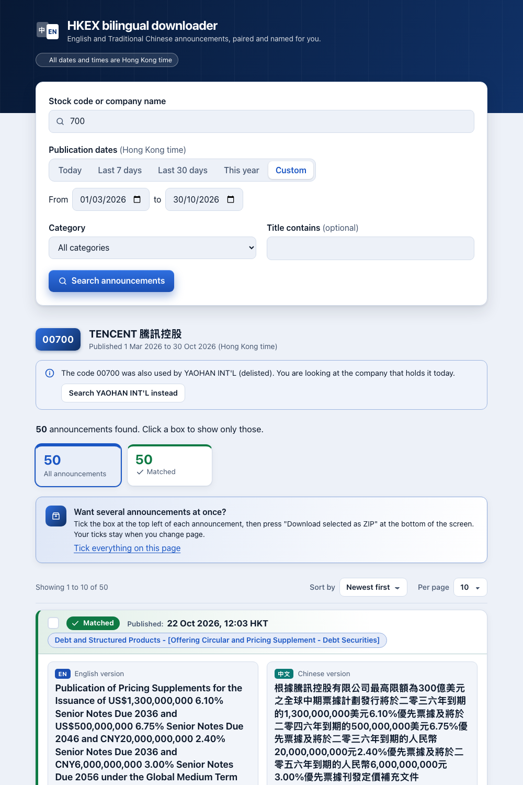

# HKEX bilingual downloader

Enter a Hong Kong stock code and a date range, browse that company's HKEXnews announcements, and
download the English and Traditional Chinese PDFs together, paired and named correctly.



## 1. Open and use it

**Open:** <https://hkex-bilingual-downloader.onrender.com/>

The app is on a free host that sleeps when nobody is using it. **The first load can take about a
minute.** After that it is fast.

1. **Search.** Type a stock code (`700`, `00700` or `700.HK`) or part of a company name, pick the
   dates (Hong Kong time) and press "Search announcements".
2. **Read the pairs.** Each announcement shows its English and Chinese version side by side with a
   status: **Matched**, **Check pairing**, **English only** or **Chinese only**. "Why this pairing"
   gives the evidence. Nothing uncertain is shown as matched.
3. **Download.** One PDF, both as a ZIP, or tick several announcements and download one ZIP. Files
   are the original PDFs, named like `EN_2026-10-15-00700-Title.pdf` and
   `TC_2026-10-15-00700-標題.pdf` (the pencil edits a name). A ZIP is offered only when every file
   in it was fully received and checked.

**A note on filenames:** HKEXnews English titles are often in ALL CAPS, so English filenames use
Title Case (`OVERSEAS REGULATORY ANNOUNCEMENT` becomes `Overseas-Regulatory-Announcement`).
Titles already in mixed case and all Chinese titles stay as published (D-004).

## 2. What you need

- **To use the hosted app:** a modern browser. No install, no account, no keys.
- **To run it yourself:** Python 3.12 with [uv](https://docs.astral.sh/uv/) and Node 22, or Docker.

```
cd frontend && npm install && npm run build && cp -r dist ../backend/static
cd ../backend && uv sync && uv run uvicorn app.main:app     # open http://127.0.0.1:8000
```

Docker: `docker build -t hkex-bd . && docker run -p 8000:8000 hkex-bd`.
Without internet, recorded data: `HKEX_MODE=fixtures uv run uvicorn app.main:app` (try `700`, 30 Sep to 30 Oct 2026).
Tests: see [TESTING.md](TESTING.md).

## 3. Costs and limits

- **Free to use.** The app is hosted on Render's free plan, which is why the first load is slow.
- It reads public documents from HKEXnews only, slowly and politely. Documents belong to their
  issuers and HKEX; the app saves them unchanged. Please read HKEXnews' terms of use before heavy use.
- Searches and downloads are limited per visitor (for example 20 searches a minute).

## 4. Known limitations

- **Pairing is by rules, not by reading the documents.** When the evidence is not strong enough the
  app says "Check pairing" and lists the candidates. It never fills a missing language with the other one.
- **Before 25 June 2007** every pair is "Check pairing" (those documents have no headline categories).
- **"Check contents"** compares figures in the two PDFs as extra evidence only. About a third of
  the Chinese PDFs sampled cannot be read, and two documents that share their figures can fool it
  (one wrong case known, M-015, open).
- **Reused stock codes** (00700 was once another company's) search today's company; earlier holders
  are one click away.
- **Web pages and multi-file entries** on HKEXnews are linked, not downloaded.
- **Large searches:** more than 20,000 documents per language asks you to narrow the dates; one ZIP
  holds up to 50 announcements or 500 MB.
- **A transfer cut off inside your browser** is shown by the browser, not by the page. The app
  checks every file before handing it over, and never reports a failed fetch as a success.
- **Not tried by hand on Windows.** The tests are set up to run on Windows too (GitHub Actions).
- **The test set of known pairs** (74 announcements, 21 issuers) was checked by AI reading and
  confirmed by a person, not by a person opening every PDF.

## 5. Reused projects and libraries

All permissive licences, listed in [THIRD_PARTY_NOTICES.md](THIRD_PARTY_NOTICES.md). Backend:
FastAPI, httpx, Pydantic, pypdf, pathvalidate. Frontend: React, Tailwind CSS, Vite. Open-source HKEX
tools were read for ideas only; no code was copied.

## 6. Time spent

About 8 hours, slightly more.

## How AI was used

Built with Claude Code (Claude Sonnet 5.5) under my direction: research and probes of HKEXnews
first, then tests, then features. Pairing was checked against a set of hand-verified pairs. The 22
mistakes the AI made and that were caught are listed in [docs/AI_LOG.md](docs/AI_LOG.md); the main
choices are in [docs/DECISIONS.md](docs/DECISIONS.md). The full specification is
[docs/SPEC.md](docs/SPEC.md).
